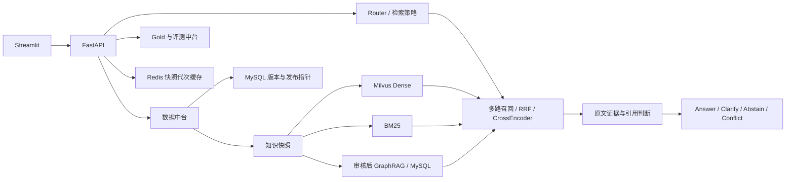
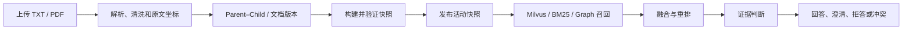
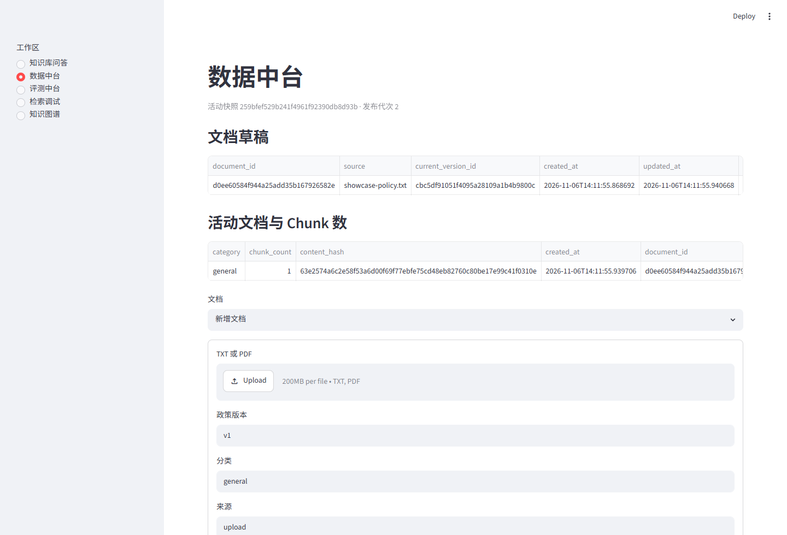
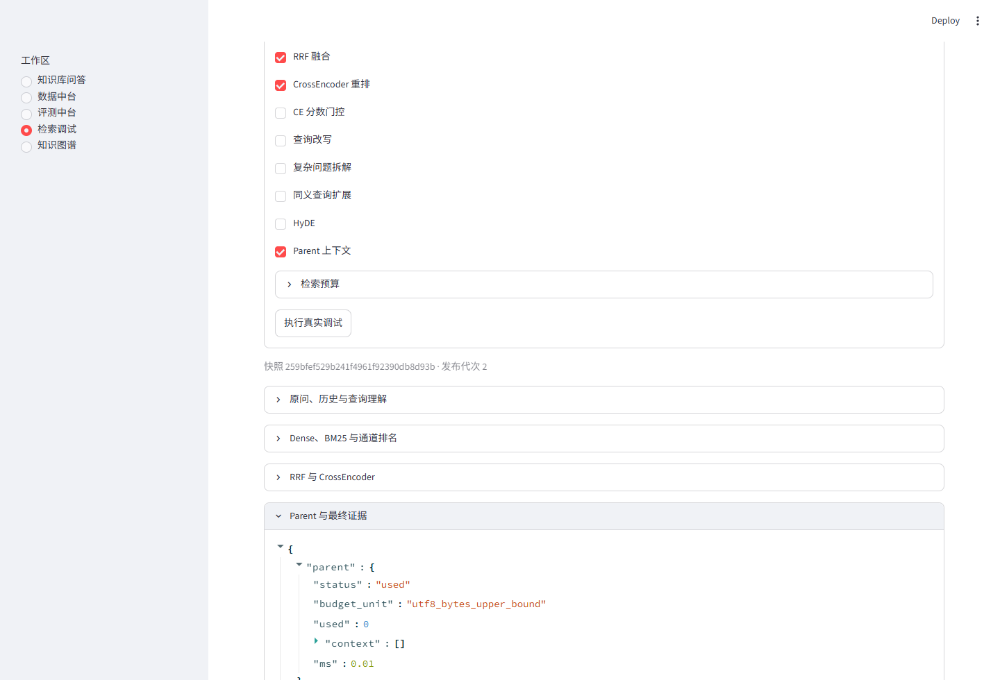
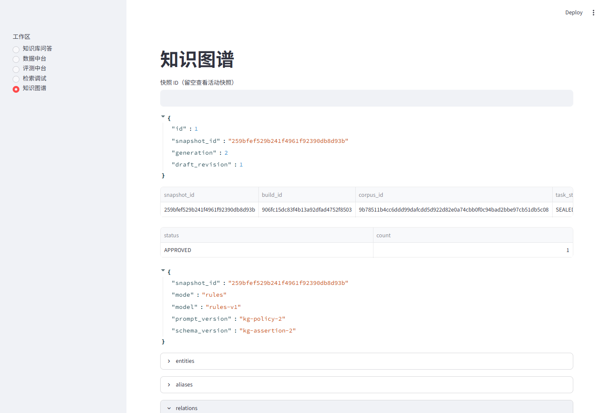
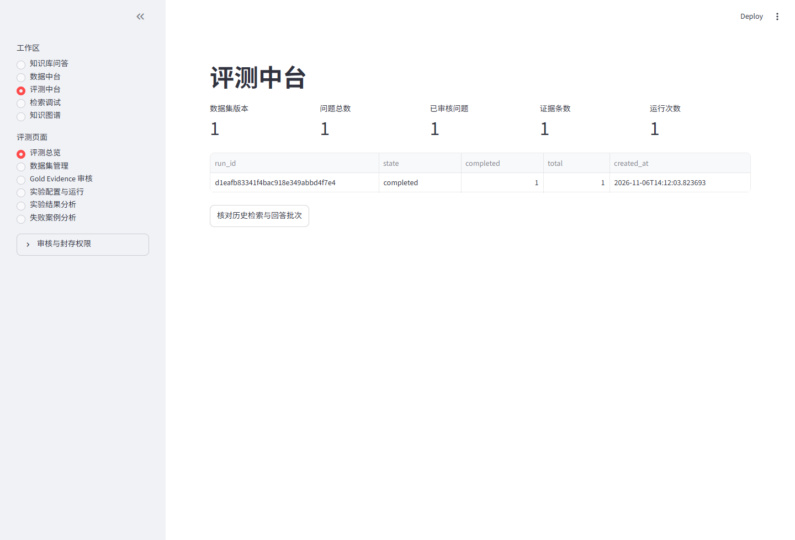

# RAG V3 — Enterprise Knowledge Base & Agentic GraphRAG

**企业级知识库问答与 Agentic GraphRAG 系统**

RAG V3 面向售后政策等需要追溯原文的知识库问答。它将文档版本、检索索引和审核后的图谱绑定到同一知识快照，让回答可以定位到文件、版本与文本位置。查询按需组合 Milvus、BM25 和图谱召回，再做融合、重排与证据判断。数据中台负责文档、图谱和发布治理，评测中台冻结 Gold Evidence，记录逐题结果和 Trace。证据不足、条件缺失或政策冲突时，可靠性接口分别返回拒答、追问或冲突状态。

| 模块 | 能力 |
| --- | --- |
| 数据中台 | TXT/PDF 解析、Parent–Child 分块、文档版本、快照发布与回滚 |
| 混合检索 | BGE 向量编码、Milvus Dense、BM25、RRF 和 CrossEncoder |
| GraphRAG | 实体与关系抽取、审核和封存，图路径回查到原文 Child |
| Agentic 检索 | 规则或模型辅助 Router、追问改写、子问拆解、按入口启用 HyDE |
| 可靠性 | 请求共享预算、范围与条件判断、原文与引用验证、可查询 Trace |
| 评测中台 | Gold 标注、数据集冻结、快照绑定、逐题评测与实验对比 |

## 架构



## 从上传到回答



快照发布在 MySQL 事务中切换活动指针。回滚复用曾发布的快照并生成新代次，Redis 缓存跟随快照与代次隔离。普通问答、结构化证据查询与可靠性接口各有独立契约。[数据与发布](docs/data-platform.md) · [检索链路](docs/rag-pipeline.md)

| 层 | 技术 |
| --- | --- |
| 应用 | Python、FastAPI、Streamlit |
| 检索 | Sentence Transformers、BGE、Milvus、BM25、RRF、CrossEncoder |
| 模型 | DeepSeek 兼容接口，可选本地替身 |
| 知识治理 | MySQL、快照制品、GraphRAG、Redis |
| 部署 | Docker Compose，Milvus 使用 etcd 和 MinIO |

## 页面演示

以下页面来自本地隔离环境的一次真实运行，使用合成政策和 Gold。

| 数据中台 | 检索与证据 |
| --- | --- |
| [](docs/images/data-platform.png) | [](docs/images/retrieval-debug.png) |
| **图谱审核与封存** | **评测中台** |
| [](docs/images/graph-review.png) | [](docs/images/evaluation-platform.png) |

## 快速启动

安装 Git、Python 3.11+ 和 Docker Compose v2，按部署指南准备两套本地 BGE 模型。复制 `.env.example` 为 `.env`，填入模型目录和新的运行目录，然后从仓库根目录运行：

```bash
python scripts/bootstrap.py --env-file .env --reviewer demo-reviewer
```

启动器创建隔离的 Compose 项目，生成私有身份与凭据，初始化空库。使用默认端口时，打开 [Streamlit](http://127.0.0.1:18632) 或 [FastAPI Swagger](http://127.0.0.1:18631/docs)。默认生成使用本地替身，可以用合成数据体验发布、检索和评测。模型下载、端口覆盖和停启命令见 [部署指南](docs/deployment.md)。

## 核心 API

| 接口 | 用途 |
| --- | --- |
| `POST /v2/documents` · `POST /v2/index-snapshots` | 接入文档与构建快照 |
| `POST /v2/index-snapshots/{snapshot_id}/publish` | 发布已验证的快照 |
| `POST /rag/query` · `POST /ask` | 返回结构化证据或生成答案 |
| `GET /v3/graph/lookup` | 在已封存且曾发布的快照上查图 |
| `POST /v2/retrieval/reliable` · `GET /v2/retrieval/reliable/{trace_id}` | 可靠性动作和 Trace |
| `/v2/evaluation/datasets` · `/v2/evaluation/runs` | 管理 Gold 和运行记录 |

查看 [API 契约](docs/api.md) 与 [评测工作流](docs/evaluation-platform.md)。

## 验证与边界

- 单元和回归测试集中在 [tests](tests)。隔离烟测覆盖真实 MySQL、Redis、Milvus、BM25 与模型加载，使用合成文档和本地生成替身。[测试方法](docs/deployment.md#回归验证)
- 历史 DeepSeek 验收使用固定题集，图谱与 Gold 的质量仍依赖人工审核。单题、定向样本与本地压测不能推断生产准确率、容量或可用性。[已知限制](docs/limitations.md)
- `main` 展示当前 Milvus V3。`v3.0.0` 标记通过此次验收的版本。`legacy-faiss-baseline` 保存可确认的旧 FAISS 基线，`backup/pre-v3-showcase` 保留此次整理前的目录与实验。当前运行仍保留既有索引恢复、接口契约及必要迁移。

[架构与源码导航](docs/architecture.md) · [GraphRAG](docs/graphrag.md) · [部署](docs/deployment.md) · [评测中台](docs/evaluation-platform.md)
