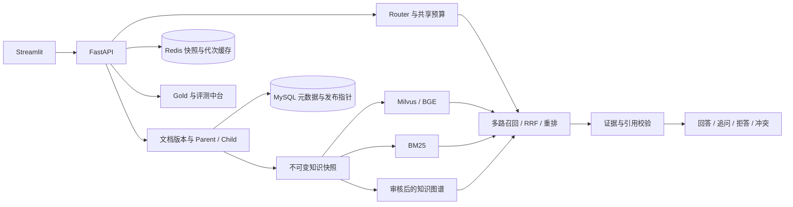

# RAG V3 · 知识库问答与 Agentic GraphRAG

一个面向可追溯文档问答的 Python 项目。它把文档版本、Milvus 向量、BM25 索引、审核后的知识图谱与原文引用绑定到同一个知识快照，支持发布、回滚、历史查询和独立评测。

## 核心能力

| 模块 | 做什么 |
| --- | --- |
| 数据中台 | 上传 TXT / PDF、记录内容哈希和版本、生成 Parent / Child 及原文位置；构建、校验、发布和回滚知识快照 |
| 混合检索 | BGE 编码、Milvus 稠密检索、BM25 稀疏检索、RRF 融合、可选 CrossEncoder 重排；按 Child 定位证据并扩展 Parent 上下文 |
| GraphRAG | 候选实体与关系抽取、人工审核、封存及发布门禁；图路径回到同一快照的 Child 和原文 |
| Agentic 检索 | 规则或模型辅助路由、查询改写、子问题分解、按配置启用 HyDE 和图检索；共享预算限制重试、并发与二次检索 |
| 可靠性 | 检查证据与引用、条件、适用范围和政策冲突；支持回答、追问、拒答和冲突动作，保留诊断 Trace |
| 评测中台 | Gold Evidence 绑定、版本与审核记录、固定快照评测、逐题诊断和跨实验对照；检索和回答指标分别记录 |

## 架构与数据流



- **知识发布：** 先创建可校验的快照制品，再用 MySQL 事务切换活动指针。回滚生成新发布代次；Redis 命名空间和缓存键包含版本边界。
- **检索与生成：** 固定一个快照，在同一视图中召回候选、重排、展开上下文并检查原文引用。Milvus 使用快照级 collection，当前索引为精确 `FLAT / L2`；旧 FAISS 代码保留用于历史兼容和迁移。
- **图谱审核：** 从指定快照抽取候选；实体、关系和原文证据通过门禁后才封存并随知识包发布。在线图检索受快照、跳数和预算约束，返回可定位的来源。
- **技术栈：** Python、FastAPI、Streamlit、Milvus / etcd / MinIO、Sentence Transformers、MySQL、Redis、DeepSeek 兼容接口、Docker Compose。

## Docker 快速开始

准备 Python 3.11+、Git 和已运行的 Docker Compose，以及两个完整的本地模型目录：[BGE Embedding](https://huggingface.co/BAAI/bge-small-zh-v1.5)、[BGE CrossEncoder](https://huggingface.co/BAAI/bge-reranker-base)。首次构建需要下载镜像和依赖。按 [部署说明](deployment/README.md) 下载模型和设置资源路径，然后在仓库根目录运行：

```bash
python deployment/bootstrap.py --resource ../rag-v3-runtime --embed ../rag-models/embed --rerank ../rag-models/rerank
```

脚本为**空白演示环境**生成隔离网络、卷、数据库和本机私有配置。API 默认在 `http://127.0.0.1:18631/docs`，Streamlit 在 `http://127.0.0.1:18632`。上传自有文档、构建并发布首个快照后即可检索。默认使用本地生成替身，适合验证检索、发布和接口链路；需要真实回答、模型路由或模型抽取时，按部署说明单独启用服务和预算。

| 配置 | 说明 |
| --- | --- |
| `RAG_DOCKER_RESOURCE`、`RAG_DOCKER_EMBED`、`RAG_DOCKER_RERANK` | Compose 运行根目录和只读模型挂载；快速启动脚本自动填写 |
| `MYSQL_*`、`RAG_V2_MYSQL_UUID` | 从私有运行清单加载，核对实际数据库、端口、UUID 和数据目录 |
| `REDIS_*`、`RAG_V2_REDIS_PREFIX` | 独立 Redis、逻辑库、实例标记和 Key 命名空间 |
| `RAG_V3_MILVUS_URI`、`RAG_V3_MILVUS_NAMESPACE` | 容器内 Milvus 服务和快照集合前缀 |
| `RAG_V2_ADMIN_TOKEN` | 本地管理 API 凭据，通过 `X-RAG-V2-Token` 发送 |
| `DEEPSEEK_*`、`RAG_LLM_COST_LEDGER` | 仅在启用受预算约束的真实模型时设置；勿提交凭据、账本或调用日志 |

## API 与评测

| 入口 | 用途 |
| --- | --- |
| `POST /ask` | 基于知识库生成回答 |
| `POST /rag/query` | 返回结构化检索证据，用于业务侧消费 |
| `POST /v2/retrieval/reliable` | 执行可靠性策略，返回动作、证据与 Trace |
| `/v2/documents`、`/v2/index-snapshots` | 文档版本、快照构建、发布与回滚 |
| `/v3/graph/overview`、`/v3/graph/{sid}/candidates` | 图谱概览、候选及审核工作流 |
| `/v2/evaluation/datasets`、`/v2/evaluation/runs` | 管理 Gold 数据集、运行及结果 |

以运行实例的 OpenAPI 为准。安装依赖后可先跑不依赖服务的单元测试：`python -m unittest test_milvus_store test_model_fingerprint test_llm_budget test_container_identity`。容器测试、人工标注及历史评测的边界见 [部署与验证说明](deployment/README.md) 和 [历史评测说明](evaluation/README.md)。

评测中台把文件级来源、Child 证据和生成质量分开记录。比较参数时固定数据集版本、快照、模型和候选集，并保留逐题记录。字符串匹配不是回答准确率；旧版实验汇总仅代表当时的数据、索引和运行配置。

## 当前限制

- 仓库公开代码、配置模板与可脱敏历史汇总。私有语料、历史快照、评测原始记录、模型权重、密钥及数据库转储需由操作者自行提供；全新启动不会恢复历史数据。
- 快速启动面向本地 CPU 演示，未提供生产认证、TLS、高可用或多租户部署。对外开放前需要独立的安全与容量验证。
- 图谱和 Gold 标注依赖人工审核；规则检索、本地模型替身、真实模型结果应分别统计。不能从这些测试推断生产准确率或吞吐量。
- `docker-compose.yml`、`evaluation/docker-compose.yml` 和历史 FAISS 实验属于旧版参考。V3 新部署使用 `compose.full-isolated.yml` 和 `compose.milvus-isolated.yml`。
